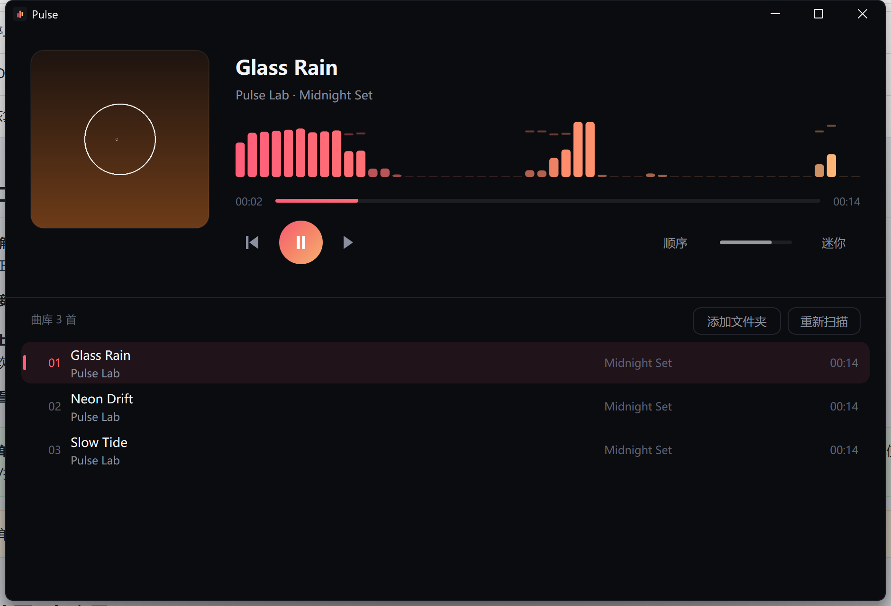
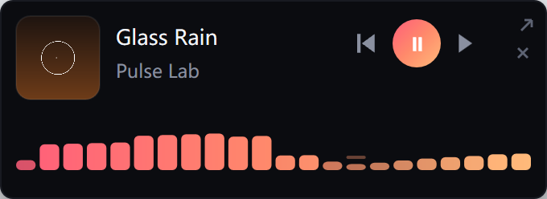

# Pulse

本地音乐播放器。C++17 / Win32，单进程、无可执行依赖，475 KB。



## 为什么重写

上一版用 WebView2 做界面，界面改起来舒服，但内存实测：

| | 工作集 | 私有 | 进程数 |
|---|---|---|---|
| WebView2 版 | 455 MB | 230 MB | 7（含 Chromium 的 browser / gpu / renderer） |
| **原生版** | **75 MB** | **54 MB** | **1** |

Chromium 的基线摆在那，把 `--enable-low-end-device-mode`、`--disable-gpu` 全试过，只省 10%，
GPU 进程 134 MB 还关不掉。所以把 Chromium 整个拿掉。

## 现在的架构

```
文件 ──IMFSourceReader──▶ 16bit PCM ──▶ 环形缓冲(2s) ──IAudioRenderClient──▶ 声卡
        (Media Foundation 解码+重采样)         │
                                              └──▶ 单声道抽样 ──FFT──▶ 频谱柱
```

- **解码**：Media Foundation。系统自带，mp3 / aac(m4a) / flac / wav / wma 都能解，
  重采样交给 MF 的 Audio Resampler，直接输出设备混音格式。
- **输出**：WASAPI 共享模式，事件驱动，20 ms 缓冲。解码线程和渲染线程用一条 2 秒的环形缓冲隔开。
- **界面**：Direct2D + DirectWrite 全自绘，没有任何控件库。
- **线程模型**：进程是 MTA（WASAPI 的 COM 对象要跨线程用）。但 Windows 的文件夹选择框
  依赖 STA，在 MTA 里调用会**直接卡死且不弹窗**，所以选择器跑在一个临时的 STA 线程上，
  结果通过 tick 回收到 UI 线程。
- **频谱**：对解码出来的 PCM 做 2048 点 FFT（汉宁窗），对数分频成 52 柱，
  再做 88 分位自动增益 + 快起慢落包络——参数和上一版 WebAudio 对齐，观感一致。

## 特性

- 本地曲库：递归扫盘，自解析 ID3v2/v1 与 FLAC 标签（标题、歌手、专辑、时长、内嵌封面）
- 频谱可视化：跟音乐实时跳动，暂停时自然落下
- 迷你模式：点最小化不是缩进任务栏，而是变成桌面右下角置顶小条，频谱照旧，可拖动，小窗里也有一条音量滑条
- 顺序 / 单曲 / 随机，进度拖动，音量，记住上次播放（记住的是文件路径，删歌后不会串到别的曲子）
- 曲库可删可恢复：移除误加的目录、移除单曲、单条或全部恢复，都只改曲库和配置，不删磁盘文件
- 深色标题栏（DWM 原生），跟随系统 DPI 缩放



## 快捷键

| 键 | 作用 |
|---|---|
| `Space` | 播放 / 暂停 |
| `←` `→` | 快退 / 快进 5 秒 |
| `↑` `↓` | 音量（主界面、迷你窗都可用；小窗里也能直接拖音量条） |
| `M` | 迷你模式 / 还原 |
| `Esc` | 从迷你模式还原 |
| `PgUp` `PgDn` | 上一首 / 下一首 |

## 用法

双击 `dist/Pulse.exe`。首次启动扫「音乐」文件夹，空的就点右上角**添加文件夹**。

也可以直接把文件夹**拖到 exe 上**，等价于「添加文件夹」；路径会写进配置，下次启动自动带上。

### 引错了怎么删

- **移除整个目录**：点列表头的**管理文件夹** → 点该目录右侧的 ×。目录会从配置里删掉并立即重新扫盘，下次启动不会再自动加回来；想加回来就再点一次「添加文件夹」。
- **移除某一首**：在曲库里把鼠标移到那一行，点右端出现的 ×。路径会记进配置的 `exclude=`，重新扫描、重启都不会回来。
- **恢复**：管理面板里每条移除记录右侧有**恢复**，右上角还有**全部恢复 N 首**；移错的目录用「添加文件夹」加回即可。

以上操作**只影响曲库和配置，不会删除磁盘上的音频文件**。配置在 `%LOCALAPPDATA%\Pulse\config.txt`，
也可以直接手动删掉对应的 `folder=` / `exclude=` 行（改完重启生效）。
移除当前正在播的那首会停下来、选中相邻一首但不自动播放。

## 构建

```bash
python build.py
```

编译器用 MinGW-w64（g++ 16.2.0 UCRT），脚本按顺序找 `toolchain/mingw64/bin/`、
`D:/WorkSpace/bilidownload/toolchain/mingw64/bin/`。链接 `d2d1 dwrite windowscodecs mfplat
mfreadwrite mfuuid dwmapi shlwapi`，全部是 Windows 自带组件。

## 目录

```
src/
  main.cpp     窗口、消息循环、键盘、迷你模式、配置
  audio.h      MF 解码线程 + WASAPI 渲染线程 + 环形缓冲
  spectrum.h   FFT、对数分频、自动增益
  ui.h         Direct2D 绘制、命中测试、封面解码
  tags.h       ID3v2/v1、FLAC 标签与封面偏移、时长估算
  library.h    扫目录建曲库
  util.h       编码转换、路径、时间
tools/drive.py 开发用：启动 + 点击 + 截图（ctypes，无第三方 GUI 库）
docs/          截图
```

## 已知限制

- **ape / dsd 不支持**：Windows 自带解码器没有它们，扫盘时直接跳过。要支持得自己链 FFmpeg。
- **没有 WASAPI 独占**：现在是共享模式，高解析音源会被系统混音器重采样。
  独占模式要自己处理格式协商和时钟漂移，属于另一个量级的工程。
- 只做本地文件，不碰在线音源。

## 许可

代码自用随意。播放的音乐版权归各自权利人所有。
